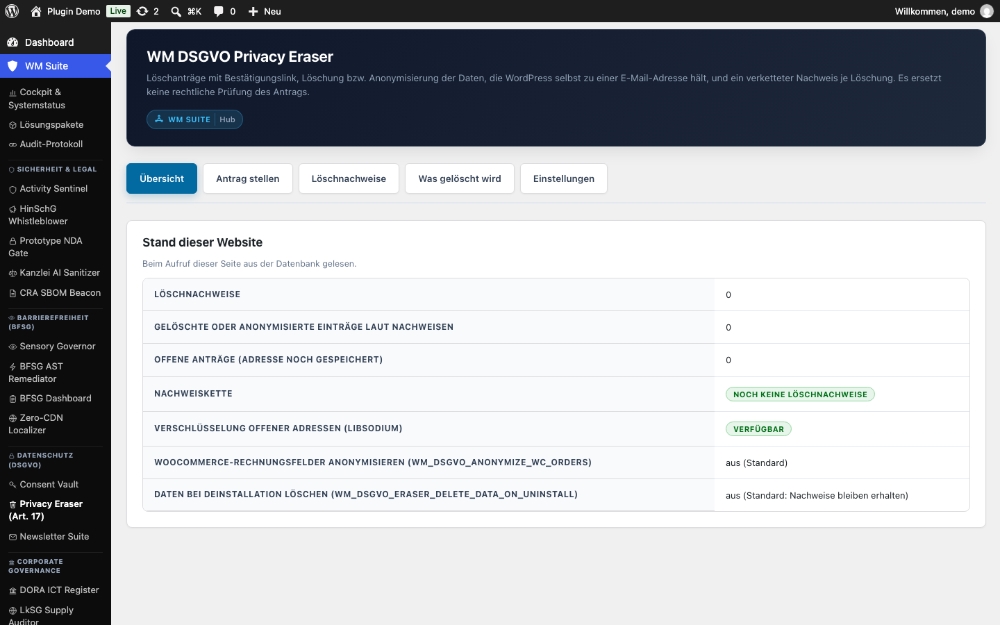
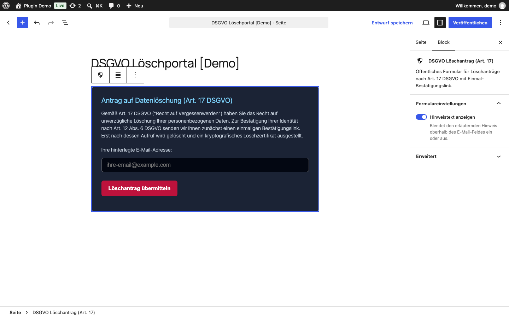
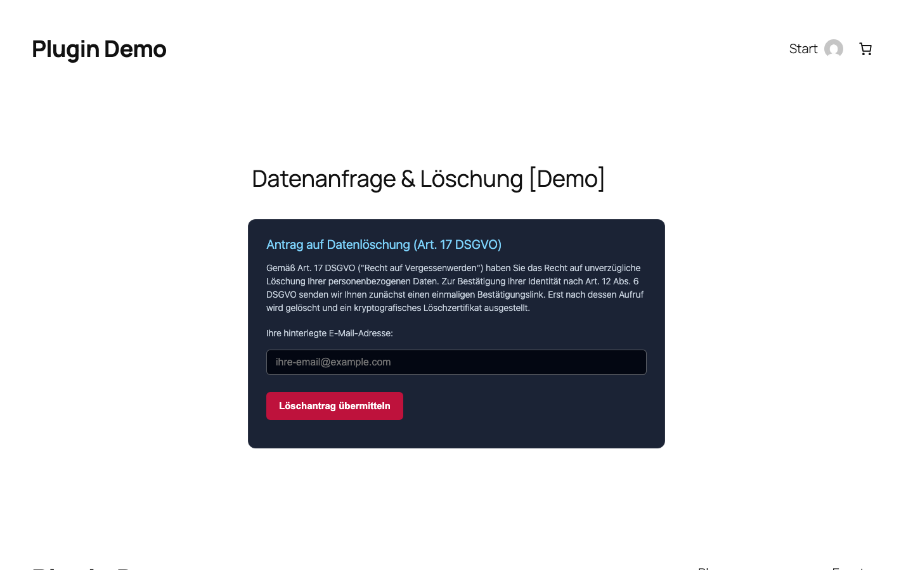

# WM DSGVO Privacy Eraser (Deutsche Dokumentation)

<p align="center">
  <a href="README.md"></a>
  <a href="README.de.md"></a>
  <a href="README.es.md"></a>
</p>

> **Nimmt Löschanträge über ein öffentliches Formular oder den Gutenberg-Block an, handelt erst, wenn jemand mit Zugriff auf das Postfach einen Einmal-Link öffnet und auf der verlinkten Seite bestätigt, anonymisiert dann die Kommentare dieser Adresse, löscht ihr Benutzerkonto (außer Administratoren), anonymisiert optional WooCommerce-Rechnungsfelder und hält die Löschung in einer HMAC-verketteten Tabelle fest — ohne rechtliche Bewertung des Antrags**  
> **Plugin-Seite:** [https://arnoldwender.com/wordpress-plugins/wm-dsgvo-privacy-eraser/](https://arnoldwender.com/wordpress-plugins/wm-dsgvo-privacy-eraser/)  
> **Mit einem agentischen Workflow entwickelt:** entstanden mit KI-Coding-Agenten. Prüfen und testen Sie es wie jeden fremden Code, bevor Sie es produktiv einsetzen.  
> **Support & Haftung:** Kein Support (Zero Support) — reproduzierbare Bugs ausschließlich über [GitHub Issues](https://github.com/arnoldwender/wm-wp-dsgvo-privacy-eraser/issues) · kein privater Support · OHNE GEWÄHR („AS IS“) / keine Haftung ([SUPPORT.md](SUPPORT.md))

> Alle hier beschriebenen Routen, Befehle, Tabellen, Optionen, Blöcke und Hooks sind direkt gegen den Quelltext in diesem Repository gemessen: Shortcode `[wm_dsgvo_erasure_portal]`, Gutenberg-Block `wm/dsgvo-erasure-portal`, WP-CLI `wp dsgvo erase|verify`, REST `/request`, `/confirm` und `/verify` unter `wm-dsgvo-eraser/v1`, Tabellen `wp_wm_dsgvo_requests` und `wp_wm_dsgvo_erasure_certificates`, Block-Bindings-Quelle `wm-dsgvo-eraser/status` sowie GenerateBlocks-Dynamic-Tag `{{wm_eraser_status}}`.

---

## Live-Vorschau

!WM DSGVO Privacy Eraser Banner

| Übersicht | Gutenberg-Block | Löschportal |
|---|---|---|
|  |  |  |

---

## Was das Plugin leistet

1. **Antragsformular & Gutenberg-Block:** `[wm_dsgvo_erasure_portal]` und der kompilierte Block `wm/dsgvo-erasure-portal` (`InspectorControls` + `ServerSideRender`, Editor-Skript `wm-dsgvo-eraser-blocks-editor`) geben ein barrierearmes Formular mit optionalem Hinweistext, beschriftetem E-Mail-Feld und Schaltfläche für `POST /wp-json/wm-dsgvo-eraser/v1/request` aus. Die Antwort ist für jede syntaktisch gültige Adresse identisch.
2. **Antrag & Rate-Limiting:** `RestController::check_public_erasure_access()` schützt `/request` und `/confirm` mit einem Transient-basierten Rate-Limit über einen gehashten IP-Schlüssel (`wm_dsgvo_rl_*`, Standard 30 Anfragen/Minute, per `wm_eraser_rest_rate_limit` filterbar, HTTP 429 bei Überschreitung, Ausnahme für `manage_options`). Zusätzlich begrenzt `ErasureRequestManager::create()` Anträge stillschweigend auf 3 je Adresse in 24 Stunden und 10 je IP pro Stunde, verschlüsselt offene Adressen mit libsodium (`secretbox`) und sendet den Einmal-Link `/?wm_dsgvo_erasure=confirm&wm_erasure_request=…&wm_erasure_token=…`.
3. **Bestätigung:** Das Öffnen des Links (GET) löscht nichts, sondern zeigt für offene, gültige Anträge ein POST-Formular. Erst das Absenden der Schaltfläche übernimmt den Antrag atomar (`claim()`), entschlüsselt die Adresse, führt die Löschung aus und entfernt Adresse sowie Token-Hash. `GET /wp-json/wm-dsgvo-eraser/v1/confirm` leitet ältere Links per 302 weiter.
4. **Löschung & Hooks:** Kommentare werden anonymisiert, Nicht-Administrator-Konten mit `wp_delete_user()` gelöscht, optional WooCommerce-Rechnungsfelder über `wc_get_orders()` überschrieben und Dritt-Tabellen über `apply_filters( 'wm_eraser_anonymize_personal_data', [], $clean_email )` eingebunden. Nach Abschluss feuert `do_action( 'wm_eraser_completed', $outcome )`.
5. **Löschnachweise:** Jede Löschung schreibt unter der MySQL-Sperre `wm_dsgvo_cert_chain` einen verketteten Eintrag (`ERASE-…`) in `wp_wm_dsgvo_erasure_certificates` und spiegelt das neueste Siegel in `wm_dsgvo_cert_chain_tip`.
6. **Ablauf-Bereinigung:** `wm_dsgvo_expire_requests` bereinigt stündlich abgelaufene Anträge.
7. **Backend & Einstellungen:** Menü *Privacy Eraser* (`wm-dsgvo-eraser`) mit den Reitern *Übersicht*, *Antrag stellen*, *Löschnachweise*, *Was gelöscht wird* und *Einstellungen* (`wm_dsgvo_anonymize_wc_orders` und `wm_dsgvo_eraser_delete_data_on_uninstall`) sowie einem Dashboard-Widget.
8. **WP-CLI & Monitoring:** `wp dsgvo erase <email>`, `wp dsgvo verify` und `GET /wp-json/wm-dsgvo-eraser/v1/verify` (`manage_options`, HTTP 409 bei Kettenbruch).
9. **Ökosystem-Brücken:** `do_action( 'wm_eraser_ready', $this )`, WP 6.5+ Block Bindings (`wm-dsgvo-eraser/status`), GenerateBlocks 2.x Dynamic Tag (`{{wm_eraser_status}}`, Filter `wm_eraser_status_text`) und WM Suite Hub Spoke (`wm_register_suite_module`).

### Nicht enthalten

Kein Datenexport nach Art. 15 oder 20 DSGVO; kein automatischer Aufruf der WordPress-eigenen Datenschutz-Werkzeuge; keine Änderung fremder Plugin-Tabellen ohne Anbindung über `wm_eraser_anonymize_personal_data`; keine rechtliche Prüfung von Anträgen, Ausnahmen nach Art. 17 Abs. 3 DSGVO oder Aufbewahrungsfristen (§ 147 AO, § 257 HGB).

---

## Schnellstart

1. Plugin installieren und aktivieren (WordPress 6.4+, PHP 8.2+, libsodium empfohlen).
2. Den Gutenberg-Block **DSGVO Löschantrag (Art. 17)** (`wm/dsgvo-erasure-portal`) oder `[wm_dsgvo_erasure_portal]` auf der Datenschutzseite einbinden.
3. Testantrag stellen, Link in der E-Mail öffnen, auf der Seite bestätigen und unter **Privacy Eraser › Löschnachweise** prüfen.
4. Unter **Privacy Eraser › Einstellungen** prüfen, ob `wm_dsgvo_anonymize_wc_orders` nach Klärung der Aufbewahrungspflichten aktiviert werden soll und ob `wm_dsgvo_eraser_delete_data_on_uninstall` ausgeschaltet bleibt (Standard: Nachweise bleiben bei Deinstallation erhalten).
5. Nachweiskette mit `wp dsgvo verify` oder `GET /wp-json/wm-dsgvo-eraser/v1/verify` überwachen.

Details für Entwickler: **[README.md](README.md)** und **[DEVELOPERS.md](DEVELOPERS.md)**.

```bash
php tests/test-suite.php
php tests/test-pot-freshness.php
bash tests/run-mutations.sh
```

---

## Konformität

- **Nachweisumfang:** Bestätigung über Einmal-Link und POST-Schaltfläche, protokollierte Änderung je Bereich und HMAC-verketteter Nachweis in der Datenbank, solange `wm_dsgvo_cert_chain_tip` und die Salts in `wp-config.php` unverändert bleiben.
- **Ausgehende Verbindungen:** ausschließlich die Bestätigungs-E-Mail über `wp_mail()`.
- **Deinstallation:** Bewahrt Optionen und Nachweistabellen standardmäßig auf; vollständige Löschung erfolgt nur nach explizitem Opt-in über `wm_dsgvo_eraser_delete_data_on_uninstall`.

---

## Lizenz

Vertrieben unter der **GNU General Public License v2 oder neuer** (`GPL-2.0-or-later`).  
Copyright (C) 2026 Arnold Wender.  
