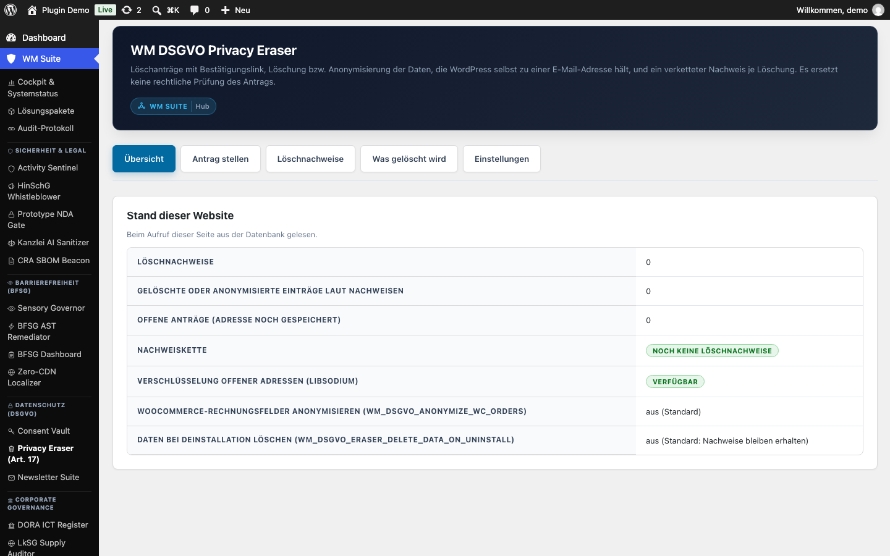
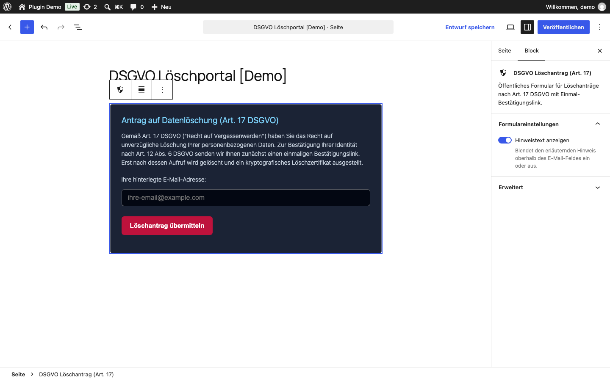
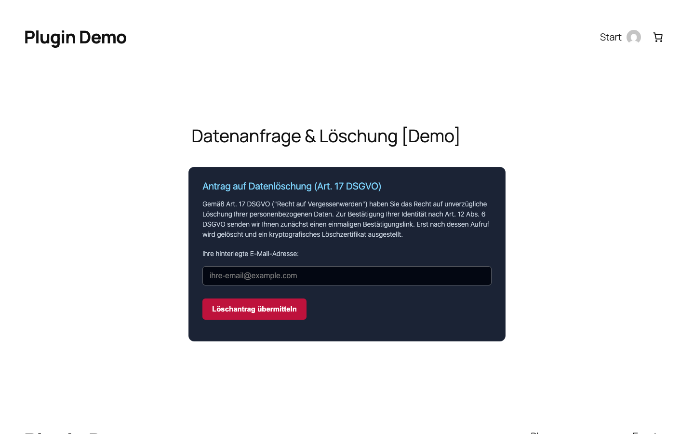

# WM DSGVO Privacy Eraser (Documentación en Español)

<p align="center">
  <a href="README.md"></a>
  <a href="README.de.md"></a>
  <a href="README.es.md"></a>
</p>

> **Recibe solicitudes de supresión mediante un formulario público o bloque Gutenberg, actúa solo cuando alguien con acceso al buzón abre un enlace de un solo uso y confirma en la página enlazada, anonimiza los comentarios de esa dirección, elimina su cuenta de usuario (salvo administradores), anonimiza opcionalmente la facturación de WooCommerce y registra el borrado en una tabla encadenada con HMAC — sin realizar valoración jurídica de la solicitud**  
> **Página del plugin:** [https://arnoldwender.com/es/plugins-wordpress/wm-dsgvo-privacy-eraser/](https://arnoldwender.com/es/plugins-wordpress/wm-dsgvo-privacy-eraser/)  
> **Desarrollado con un agentic workflow:** creado con agentes de programación de IA. Revísalo y pruébalo como cualquier código de terceros antes de usarlo en producción.  
> **Soporte y responsabilidad:** Cero soporte (Zero Support) — errores reproducibles únicamente en [GitHub Issues](https://github.com/arnoldwender/wm-wp-dsgvo-privacy-eraser/issues) · sin soporte privado · TAL CUAL («AS IS») / sin responsabilidad ([SUPPORT.md](SUPPORT.md))

> Todas las rutas, comandos, tablas, opciones, bloques y hooks descritos aquí están verificados directamente frente al código del repositorio: shortcode `[wm_dsgvo_erasure_portal]`, bloque Gutenberg `wm/dsgvo-erasure-portal`, WP-CLI `wp dsgvo erase|verify`, REST `/request`, `/confirm` y `/verify` bajo `wm-dsgvo-eraser/v1`, tablas `wp_wm_dsgvo_requests` y `wp_wm_dsgvo_erasure_certificates`, origen de Block Bindings `wm-dsgvo-eraser/status` y etiqueta dinámica de GenerateBlocks `{{wm_eraser_status}}`.

---

## Capturas en vivo

!Banner de WM DSGVO Privacy Eraser

| Resumen | Bloque Gutenberg | Portal público |
|---|---|---|
|  |  |  |

---

## Qué hace el plugin

1. **Formulario y bloque Gutenberg:** `[wm_dsgvo_erasure_portal]` y el bloque compilado `wm/dsgvo-erasure-portal` (`InspectorControls` + `ServerSideRender`, script de editor `wm-dsgvo-eraser-blocks-editor`) muestran un formulario accesible con texto explicativo opcional, campo de correo etiquetado y envío a `POST /wp-json/wm-dsgvo-eraser/v1/request`. La respuesta es idéntica para cualquier dirección válida.
2. **Solicitud y límite de peticiones:** `RestController::check_public_erasure_access()` protege `/request` y `/confirm` mediante un límite por minuto basado en transients con HMAC-SHA256 de la IP (`wm_dsgvo_rl_*`, 30 peticiones/min por defecto, filtrable con `wm_eraser_rest_rate_limit`, HTTP 429 al superarse y exento para `manage_options`), además de los topes de 3 solicitudes por dirección en 24 h y 10 por IP y hora, cifrando direcciones pendientes con libsodium (`secretbox`).
3. **Confirmación:** Abrir el enlace del correo (GET) no borra nada; solo el POST del botón en la página de confirmación reclama atómicamente la solicitud (`claim()`), descifra el correo, ejecuta la supresión y limpia dirección y hash de token. `GET /wp-json/wm-dsgvo-eraser/v1/confirm` redirige (302) los enlaces antiguos.
4. **Borrado y extensibilidad:** Anonimiza comentarios, elimina cuentas no administradoras con `wp_delete_user()`, anonimiza pedidos de WooCommerce cuando `wm_dsgvo_anonymize_wc_orders` está activo, permite integrar tablas propias mediante `apply_filters( 'wm_eraser_anonymize_personal_data', [], $clean_email )` y emite `do_action( 'wm_eraser_completed', $outcome )`.
5. **Registros encadenados:** Cada borrado añade una fila `ERASE-…` en `wp_wm_dsgvo_erasure_certificates` bajo bloqueo MySQL `wm_dsgvo_cert_chain` y refleja el último sello en `wm_dsgvo_cert_chain_tip`.
6. **Limpieza horaria:** El evento cron `wm_dsgvo_expire_requests` limpia solicitudes caducadas.
7. **Administración y ajustes:** Menú *Privacy Eraser* (`wm-dsgvo-eraser`) con pestañas *Übersicht*, *Antrag stellen*, *Löschnachweise*, *Was gelöscht wird* y *Einstellungen* (`wm_dsgvo_anonymize_wc_orders` y `wm_dsgvo_eraser_delete_data_on_uninstall`), además de widget en el escritorio.
8. **WP-CLI y monitoreo:** `wp dsgvo erase <email>`, `wp dsgvo verify` y `GET /wp-json/wm-dsgvo-eraser/v1/verify` (`manage_options`, HTTP 409 si la cadena falla).
9. **Integraciones:** `do_action( 'wm_eraser_ready', $this )`, WP 6.5+ Block Bindings (`wm-dsgvo-eraser/status`), GenerateBlocks 2.x Dynamic Tag (`{{wm_eraser_status}}`, filtro `wm_eraser_status_text`) y adaptador para WM Suite Hub (`wm_register_suite_module`).

### No incluido

Sin exportación de datos personales (Art. 15 o 20 del RGPD); sin invocación automática de los borradores internos de WordPress; sin cambios en tablas de terceros salvo integración con `wm_eraser_anonymize_personal_data`; sin dictamen jurídico sobre excepciones del Art. 17.3 del RGPD o plazos fiscales de conservación (§ 147 AO, § 257 HGB).

---

## Inicio rápido

1. Instala y activa el plugin (WordPress 6.4+, PHP 8.2+, libsodium recomendado).
2. Inserta el bloque **DSGVO Löschantrag (Art. 17)** (`wm/dsgvo-erasure-portal`) o `[wm_dsgvo_erasure_portal]` en tu página de privacidad.
3. Envía una solicitud de prueba, abre el enlace recibido por correo, confirma en la página y revisa **Privacy Eraser › Löschnachweise**.
4. Revisa **Privacy Eraser › Einstellungen**: mantén `wm_dsgvo_anonymize_wc_orders` desactivado hasta verificar tus obligaciones de conservación y deja `wm_dsgvo_eraser_delete_data_on_uninstall` desactivado salvo que desees borrar también los registros al desinstalar.
5. Supervisa la cadena mediante `wp dsgvo verify` o `GET /wp-json/wm-dsgvo-eraser/v1/verify`.

Documentación técnica completa: **[README.md](README.md)** y **[DEVELOPERS.md](DEVELOPERS.md)**.

```bash
php tests/test-suite.php
php tests/test-pot-freshness.php
bash tests/run-mutations.sh
```

---

## Cumplimiento

- **Constancia técnica:** confirmación mediante enlace único y formulario POST, recuento real por área y registro encadenado con HMAC mientras `wm_dsgvo_cert_chain_tip` y las sales de `wp-config.php` permanezcan intactos.
- **Conexiones salientes:** únicamente el correo de confirmación vía `wp_mail()`.
- **Desinstalación:** conserva opciones y tablas de registros por defecto salvo activación expresa de `wm_dsgvo_eraser_delete_data_on_uninstall`.

---

## Licencia

Distribuido bajo licencia **GNU General Public License v2 o posterior** (`GPL-2.0-or-later`).  
Copyright (C) 2026 Arnold Wender.  
